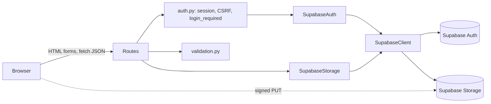
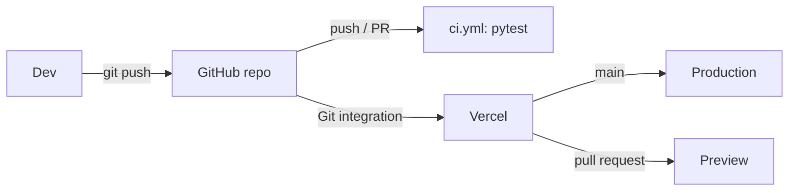

# Design Document

## Overview

CloudVault is a small multi-user Flask app built with the application factory pattern. Users register and sign in with email and password, then upload, list, view, download, and delete their own files. The stack is Supabase (Auth and private Storage), GitHub (source and CI), and Vercel (hosting through the Git integration). There is no local mode and no other storage backend.

Key decisions:

- Plain `requests` (pinned) against Supabase REST endpoints, wrapped in one `SupabaseClient` with timeouts. No Supabase SDK. Tests inject a fake `requests`-style session (Fake_Supabase).
- Three small modules sit on the client: `supabase_auth.py`, `supabase_storage.py`, and `supabase_client.py`. No backend abstraction.
- User identity always comes from the Flask session, never request input. Every storage call receives a `UserContext(user_id, access_token)`.
- Isolation is enforced twice: keys are `<user_id>/<name>`, and calls use the user's access token so RLS applies. CloudVault never references the service role key.
- Vercel limits request bodies to about 4.5 MB. The browser asks CloudVault for a signed upload URL (JSON under 4 KB) and PUTs the file straight to Supabase Storage. CloudVault never receives file content.
- Tokens live in the signed Flask cookie session. Expired access tokens are refreshed inside `login_required`.
- The app writes nothing to disk (Vercel's file system is read-only).
- Code examples use Python 3.

## Project Structure

```
code-vault/
├── .github/workflows/ci.yml  # pytest on push and PR, no secrets
├── api/index.py              # Vercel entrypoint: app = create_app()
├── app/
│   ├── __init__.py           # create_app(): wiring, error handlers, cookie settings
│   ├── config.py             # Config dataclass, env loading, validation
│   ├── auth.py               # login/register/logout routes, login_required, CSRF helpers
│   ├── supabase_client.py    # SupabaseClient: requests wrapper with timeouts
│   ├── supabase_auth.py      # SupabaseAuth (GoTrue calls), AuthResult, auth exceptions
│   ├── supabase_storage.py   # SupabaseStorage, UserContext, FileRecord, storage exceptions
│   ├── routes.py             # dashboard + /api/files endpoints
│   ├── validation.py         # filename, extension, size, email/password; format_size
│   ├── templates/            # base, login, register, files, error
│   └── static/{css,js}/      # styles.css, app.js
├── tests/                    # conftest.py, fakes.py (Fake_Supabase), test_*.py
├── run.py                    # local entry point (python run.py)
├── vercel.json
├── requirements.txt          # exact pins
├── .env.example
├── .gitignore
└── README.md
```

Deleted from the current code: `app/storage/local.py`, `app/storage/s3.py`, and the `app/storage/` package (replaced by `app/supabase_storage.py`). Removed from config and docs: `ADMIN_USERNAME`, `ADMIN_PASSWORD`, `S3_BUCKET_NAME`, `AUTH_BACKEND`, `STORAGE_BACKEND`, `LOCAL_*`, `boto3`, `moto`.

## Architecture



### Upload flow

```mermaid
sequenceDiagram
    participant B as Browser
    participant C as CloudVault
    participant S as Supabase Storage
    B->>C: POST /api/files/upload-url {name,size} + CSRF
    C->>C: validate name, ext, size; key = user_id/name
    C->>S: POST /storage/v1/object/upload/sign/bucket/key (user token, x-upsert)
    S-->>C: {url, token}
    C-->>B: {url, token, path, name}
    B->>S: PUT signed url (XHR, progress events)
    S-->>B: 200
    B->>C: GET /api/files (refresh list)
```

### GitHub and Vercel flow



## Components and Interfaces

### Config (`app/config.py`)

```python
@dataclass(frozen=True)
class Config:
    secret_key: str
    supabase_url: str                    # trailing slash stripped
    supabase_anon_key: str
    supabase_bucket: str
    allowed_extensions: frozenset[str]   # default pdf,txt,docx,xlsx,csv,png,jpg,gif
    max_upload_size: int                 # default 10_485_760
    production: bool                     # VERCEL set, or SESSION_COOKIE_SECURE in ("1","true")
    signed_url_ttl: int = 60
```

`from_env` raises `ConfigError` naming the first missing variable among `SECRET_KEY`, `SUPABASE_URL`, `SUPABASE_ANON_KEY`, `SUPABASE_BUCKET`. `ALLOWED_EXTENSIONS` (comma separated, lowercased) and `MAX_UPLOAD_SIZE` (positive int) fall back to defaults when unset. No service role key is read. `run.py` calls `load_dotenv()` before `create_app()`.

### SupabaseClient (`app/supabase_client.py`)

```python
class SupabaseClient:
    def __init__(self, url, anon_key, session=None, timeout=(3.05, 10)):
        self.base = url.rstrip("/")
        self.anon_key = anon_key
        self.http = session or requests.Session()
        self.timeout = timeout

    def request(self, method, path, *, token=None, json=None, params=None, headers=None):
        h = {"apikey": self.anon_key, "Authorization": f"Bearer {token or self.anon_key}"}
        h.update(headers or {})
        try:
            return self.http.request(method, self.base + path, json=json,
                                     params=params, headers=h, timeout=self.timeout)
        except requests.RequestException as exc:
            raise SupabaseError("Supabase request failed") from exc
```

| Purpose | Call |
|---|---|
| Register | `POST /auth/v1/signup` `{email, password}` |
| Login | `POST /auth/v1/token?grant_type=password` |
| Refresh | `POST /auth/v1/token?grant_type=refresh_token` `{refresh_token}` |
| Logout | `POST /auth/v1/logout` (user token) |
| List | `POST /storage/v1/object/list/<bucket>` `{prefix, limit, offset, sortBy}` |
| Signed upload | `POST /storage/v1/object/upload/sign/<bucket>/<key>` with `x-upsert: true` |
| Signed read | `POST /storage/v1/object/sign/<bucket>/<key>` `{expiresIn: 60}` |
| Delete | `DELETE /storage/v1/object/<bucket>/<key>` |

Response bodies, keys, and tokens are never logged or returned to users; only exception class names and HTTP status are logged.

### SupabaseAuth (`app/supabase_auth.py`)

```python
@dataclass(frozen=True)
class AuthResult:
    user_id: str; email: str; access_token: str; refresh_token: str; expires_at: int

class AuthError(Exception): ...
class InvalidCredentials(AuthError): ...
class EmailNotConfirmed(AuthError): ...
class RegistrationFailed(AuthError): ...

class SupabaseAuth:
    def __init__(self, client: SupabaseClient): ...
    def register(self, email, password) -> None
    def login(self, email, password) -> AuthResult
    def refresh(self, refresh_token) -> AuthResult
    def logout(self, access_token) -> None
```

- `register`: a 200 returns normally whether or not the email already exists (GoTrue obfuscates existing users). Other statuses and network errors raise `RegistrationFailed`. The route shows the same "check your inbox" message either way (Req 1.3, 1.5).
- `login`: 200 builds `AuthResult` (`expires_at` from the response or `now + expires_in`). 400 with `error_code == "email_not_confirmed"` raises `EmailNotConfirmed`. Other 400/401 raise `InvalidCredentials`. Network or 5xx raise `AuthError`.
- `refresh`: 200 returns a new `AuthResult`; anything else raises `AuthError`.
- `logout`: best effort; failures are logged and swallowed because the local session is cleared regardless.

### Auth routes and helpers (`app/auth.py`)

`get_csrf_token`, `_csrf_valid` (uses `hmac.compare_digest`), and `csrf_protect` are reused. Changed or added:

```python
SESSION_KEYS = ("user_id", "email", "access_token", "refresh_token", "expires_at", "csrf_token")

def login_required(view):
    @wraps(view)
    def wrapped(*a, **kw):
        if not session.get("user_id"):
            return _unauth()
        if session.get("expires_at", 0) <= time.time() + 30:   # 30 s skew
            try:
                _store(current_app.extensions["cloudvault_auth"].refresh(session["refresh_token"]))
            except AuthError:
                session.clear()
                return _unauth()
        return view(*a, **kw)
    return wrapped

def _unauth():
    if request.path.startswith("/api/"):
        return jsonify(error="Authentication required"), 401
    return redirect(url_for("auth.login"))
```

Routes:

- `GET/POST /login`: GET redirects to `/` when signed in. POST checks CSRF, calls `login`. On success it clears the session, stores `SESSION_KEYS`, regenerates the CSRF token, and redirects to `/`. `InvalidCredentials` and `AuthError` show "Invalid email or password." with no session. `EmailNotConfirmed` shows "Please confirm your email address before logging in."
- `GET/POST /register`: GET redirects to `/` when signed in. POST checks CSRF and `validate_credentials`, returning 400 with the violated rule. On success it renders "Check your inbox to confirm your account." with no session. `RegistrationFailed` shows a generic error and no session.
- `POST /logout`: `csrf_protect`; requires a session but skips the refresh step so it works with an expired token. Calls `logout(access_token)`, clears the session, redirects to `/login`.

Session cookie size: the session holds six small fields and a Supabase access token JWT is about 1 to 1.5 KB, so the signed cookie stays near 2 KB against the 4 KB browser cap. Only `SESSION_KEYS` are stored (no user metadata). A warning is logged if the encoded session exceeds 3,800 bytes.

### Validation (`app/validation.py`)

Reuse `sanitize_filename`, `extension_allowed` (case-insensitive), `format_size`, and `UploadRejected`. The multipart `validate_upload(file_storage, config)` is deleted. Added:

```python
EMAIL_RE = re.compile(r"^[^@\s]+@[^@\s]+\.[^@\s]+$")
PREVIEW_MIME = {"png": "image/png", "jpg": "image/jpeg", "gif": "image/gif",
                "pdf": "application/pdf", "txt": "text/plain", "csv": "text/plain"}

def validate_credentials(email, password) -> str:
    """Return the normalized (lowercased) email or raise UploadRejected(msg, 400).
    Email <= 254 chars and matches EMAIL_RE; password 8..128 chars."""

def validate_declared_upload(name, size, config) -> str:
    secure = sanitize_filename(name if isinstance(name, str) else "")
    if not secure:
        raise UploadRejected("Invalid file name.", 400)
    if not extension_allowed(secure, config.allowed_extensions):
        raise UploadRejected("Allowed types: " + ", ".join(sorted(config.allowed_extensions)), 400)
    if isinstance(size, bool) or not isinstance(size, int) or size < 1:
        raise UploadRejected("File size must be a positive integer.", 400)
    if size > config.max_upload_size:
        raise UploadRejected(f"Maximum file size is {format_size(config.max_upload_size)}.", 413)
    return secure

def preview_mimetype(name) -> str | None: ...
```

### SupabaseStorage (`app/supabase_storage.py`)

```python
@dataclass(frozen=True)
class UserContext: user_id: str; access_token: str

@dataclass(frozen=True)
class FileRecord: name: str; size: int; uploaded_at: datetime   # tz-aware UTC

class StorageError(Exception): ...
class FileNotFound(StorageError): ...
class InvalidFileName(StorageError): ...

class SupabaseStorage:
    def __init__(self, client, bucket, supabase_url): ...
    def list(self, ctx) -> list[FileRecord]                  # newest first
    def exists(self, ctx, name) -> bool
    def delete(self, ctx, name) -> None                      # FileNotFound if absent
    def create_upload_url(self, ctx, name) -> dict           # {url, token, path}
    def download_url(self, ctx, name, ttl) -> str            # attachment disposition
    def view_url(self, ctx, name, ttl) -> str                # inline disposition
```

- `key(ctx, name) = f"{ctx.user_id}/{name}"`. `name` must be non-empty and contain no `/`, `\`, NUL, and not be `.` or `..`, else `InvalidFileName` (400).
- `list`: `POST /object/list/<bucket>` with `prefix=user_id`, `limit=1000`, sorted by `created_at` desc. Entries with a null `id` (folder placeholders) are skipped. Paging beyond 1000 files is out of scope.
- `exists`: list with `search=name` and an exact-name filter.
- `delete`: `exists` first (404 if missing), then `DELETE`, because Storage can report success for a missing key.
- `download_url` and `view_url`: check `exists`, then `POST /object/sign/<bucket>/<key>` with `expiresIn=ttl`. The returned `signedURL` is relative to `/storage/v1`, so it is prefixed with `<supabase_url>/storage/v1`. Download appends `&download=<urlquoted name>`; view uses the URL unchanged (inline).
- `create_upload_url`: `POST /object/upload/sign/<bucket>/<key>` with `x-upsert: true`, which allows replacing an existing file. Returns `{"url": absolute url, "token": token, "path": key}`; the token is parsed from the URL query if absent from the body.
- Status mapping: 404 maps to `FileNotFound`; 401/403/5xx/network errors map to `StorageError` (HTTP 502, generic message).
- Every call passes `token=ctx.access_token`, so RLS authorizes it.

Browser PUT: `PUT <supabase_url>/storage/v1/object/upload/sign/<bucket>/<key>?token=<token>` with a `FormData` body (field `file`, `cacheControl`) and header `x-upsert: true`, matching supabase-js `uploadToSignedUrl`. The `url` in the sign response is authoritative; the implementation task verifies the shape against current Supabase docs. Because Supabase receives the content directly, the Bucket file size limit (set to `MAX_UPLOAD_SIZE` per the README) is the independent size enforcement. The signed URL is bound to one key.

### Routes (`app/routes.py`)

| Method | Path | Notes |
|---|---|---|
| GET | `/` | `login_required`; renders `files.html` with allowed extensions, max size, previewable types |
| GET | `/api/files` | list, newest first, `uploaded_at` ISO UTC |
| POST | `/api/files/upload-url` | JSON `{name, size}`; `csrf_protect`; body capped at 4 KB; returns `{url, token, path, name}` |
| GET | `/api/files/<name>/view` | previewable check, then 302 to inline Signed_URL |
| GET | `/api/files/<name>/download` | 302 to attachment Signed_URL |
| DELETE | `/api/files/<name>` | `csrf_protect` |

```python
@bp.route("/api/files/upload-url", methods=["POST"])
@login_required
@csrf_protect
def upload_url():
    if request.content_length is None or request.content_length > 4096:
        raise UploadRejected("Request too large.", 413)
    data = request.get_json(silent=True) or {}
    name = validate_declared_upload(data.get("name"), data.get("size"), _config())
    info = _storage().create_upload_url(_ctx(), name)
    return jsonify(**info, name=name)
```

`view`: an extension outside `PREVIEW_MIME` returns 400 "Preview is not available for this file type."; otherwise redirect to `view_url`. `csrf_protect` accepts the `X-CSRF-Token` header for JSON and XHR calls. `_ctx()` builds `UserContext` from the session only.

### App factory (`app/__init__.py`)

- `create_app(config=None, supabase_client=None)`: loads config, builds one `SupabaseClient` (or uses the injected one with a fake session), and stores `cloudvault_config`, `cloudvault_auth`, `cloudvault_storage` in `app.extensions`.
- Cookie settings: `SESSION_COOKIE_HTTPONLY=True`, `SESSION_COOKIE_SAMESITE="Lax"`, `SESSION_COOKIE_SECURE=config.production`.
- A context processor injects `authenticated` and `user_email`.
- Error handlers: `UploadRejected` returns its status and message; `FileNotFound` 404; `InvalidFileName` 400; `StorageError` and `SupabaseError` 502 with a generic message; any other exception logs server-side and returns a generic 500 with no stack trace.

### Frontend (`app.js`, templates)

- `base.html`: navbar with app name, `{{ user_email }}` (auto-escaped), and a logout form with CSRF; the status region keeps `aria-live`.
- `register.html` mirrors `login.html`; the login page links to Register.
- `app.js`: `validateFile` runs before any request. `submit` calls `fetch('/api/files/upload-url', ...)` with `X-CSRF-Token`, then `putSigned(url, file)`, an XHR `PUT` with `FormData` and `x-upsert: true` whose `upload.onprogress` drives the progress bar. Failures hide the progress bar and show the message; success shows a message and reloads the list. The multipart upload path is removed.
- `renderRow` adds View: an `<a target="_blank" rel="noopener">` for previewable extensions, otherwise a disabled button with a `title` and visible text "Preview unavailable". File names are inserted with `textContent` only.
- Only the CSRF token reaches JavaScript (meta tag); the refresh token never does.

### Vercel

`api/index.py`:

```python
from app import create_app
app = create_app()
```

`vercel.json`:

```json
{ "rewrites": [{ "source": "/(.*)", "destination": "/api/index" }] }
```

Static assets are served by Flask through the same function under the rewrite (`static_folder` is `app/static`). The trade-off is that static requests run the function. Vercel installs the root `requirements.txt`. Production mode is inferred from the `VERCEL` variable that Vercel sets, with `SESSION_COOKIE_SECURE=1` as a manual override.

### GitHub

- `.gitignore`: `.env`, `.venv/`, `__pycache__/`, `.pytest_cache/`, `.hypothesis/`, `.vercel/`.
- `.github/workflows/ci.yml`: triggers on `push` and `pull_request`; one job on `ubuntu-latest` with steps `actions/checkout`, `actions/setup-python` (python-version `3.12`), `pip install -r requirements.txt`, `pytest`. It uses no secrets; tests run against Fake_Supabase with dummy env values set in `conftest.py`.

```yaml
name: CI
on: [push, pull_request]
jobs:
  test:
    runs-on: ubuntu-latest
    steps:
      - uses: actions/checkout@v4
      - uses: actions/setup-python@v5
        with: { python-version: "3.12" }
      - run: pip install -r requirements.txt
      - run: pytest
```

- `requirements.txt`: `Flask`, `python-dotenv`, `requests`, `pytest`, `hypothesis`, each pinned with `==` to the current release at implementation time. No `boto3` or `moto`.

### README outline

1. Overview; the project creates no Supabase resources and runs no deployment commands.
2. Supabase setup: enable email/password sign-in, require email confirmation, set the site URL and redirect URLs (`http://localhost:5000/**` and the Vercel domain), create a private bucket with file size limit equal to `MAX_UPLOAD_SIZE`, run the RLS SQL.
3. Environment variables table: `SUPABASE_URL`, `SUPABASE_ANON_KEY`, `SUPABASE_BUCKET`, `SECRET_KEY` (required); `ALLOWED_EXTENSIONS`, `MAX_UPLOAD_SIZE` (optional).
4. Local run: copy `.env.example` to `.env`, then `python run.py`.
5. GitHub: create a repository, `git remote add origin ...`, `git push -u origin main`.
6. Vercel: import the GitHub repo, set the four required variables in the Vercel dashboard (never in the repo); pushes to `main` deploy to production and pull requests get preview deployments.
7. Security: never configure the service role key in CloudVault or expose it to the browser.
8. Tests: `pytest`.

RLS SQL (the reader substitutes the bucket name):

```sql
create policy "users select own files" on storage.objects
  for select to authenticated
  using (bucket_id = '<bucket>' and (storage.foldername(name))[1] = auth.uid()::text);

create policy "users insert own files" on storage.objects
  for insert to authenticated
  with check (bucket_id = '<bucket>' and (storage.foldername(name))[1] = auth.uid()::text);

create policy "users update own files" on storage.objects
  for update to authenticated
  using (bucket_id = '<bucket>' and (storage.foldername(name))[1] = auth.uid()::text)
  with check (bucket_id = '<bucket>' and (storage.foldername(name))[1] = auth.uid()::text);

create policy "users delete own files" on storage.objects
  for delete to authenticated
  using (bucket_id = '<bucket>' and (storage.foldername(name))[1] = auth.uid()::text);
```

## Data Models

Session: `user_id`, `email`, `access_token`, `refresh_token`, `expires_at`, `csrf_token`. Object key: `<user_id>/<secure_filename>`. `AuthResult`, `UserContext`, and `FileRecord` are defined above.

JSON shapes: `GET /api/files` returns `{files:[{name,size,uploaded_at}]}`; `POST /api/files/upload-url` returns `{url,token,path,name}`; errors return `{error: "<message>"}`.

## Error Handling

| Condition | Status | Response |
|---|---|---|
| Missing session or failed refresh (page) | 302 | redirect to `/login`, session cleared on failed refresh |
| Missing session or failed refresh (API) | 401 | `{error}` |
| Bad CSRF token | 400 | "Invalid CSRF token" |
| Malformed email or short password | 400 | violated rule |
| Bad credentials, duplicate email | 200 | generic message |
| Unconfirmed email | 200 | "confirm your email before login" |
| Registration backend failure | 200 | generic error, no session |
| Disallowed extension, empty name, bad declared size | 400 | specific message |
| Size above maximum, upload-URL body above 4 KB | 413 | message |
| View of non-previewable type | 400 | message |
| Invalid object name | 400 | "Invalid file name." |
| File not found (including another user's file) | 404 | "File not found." |
| Supabase failure or timeout | 502 | generic storage message |
| Unhandled exception | 500 | generic message; stack trace logged server-side only |

Supabase response bodies, tokens, and keys are never logged or returned. A 404 for another user's file is indistinguishable from a missing file.

## Correctness Properties

*A property is a characteristic or behavior that should hold true across all valid executions of a system-essentially, a formal statement about what the system should do. Properties serve as the bridge between human-readable specifications and machine-verifiable correctness guarantees.*

Reflection: credential validation, generic errors, and access control stay separate because they exercise different code paths. Signed-URL checks for view and download are merged into one property. Per-user key scoping and cross-user 404 are merged into one isolation property. Delete and not-found are merged.

### Property 1: Credential validation

For any email string and password string, `validate_credentials` accepts the pair if and only if the email is well formed (at most 254 characters) and the password has 8 to 128 characters; otherwise registration is rejected with HTTP status 400 and no Supabase signup call is made.

**Validates: Requirements 1.4**

### Property 2: Generic authentication errors

For any login with an unknown email or wrong password, and for any registration of an already registered email, the response status and message are identical across the failing cases, reveal neither whether the email exists nor which field was wrong, and create no Session.

**Validates: Requirements 1.5, 2.2**

### Property 3: Access control on protected routes

For any protected route (dashboard, list, upload-url, view, download, delete) requested without a valid Session, page requests are redirected to the login page, API requests receive HTTP status 401, and no Supabase Storage call is made.

**Validates: Requirements 4.1, 11.3, 12.6**

### Property 4: CSRF enforcement

For any state-changing endpoint (login, register, logout, upload-url, delete) and any missing or non-matching CSRF token, the request is rejected with HTTP status 400 and causes no state change; a matching token is accepted.

**Validates: Requirements 5.2**

### Property 5: Token refresh on expiry

For any Session and any `expires_at` value, an authenticated request triggers exactly one refresh call if and only if the access token has expired; a successful refresh replaces the stored tokens, and a failed refresh clears the Session and yields a redirect (page) or 401 (API).

**Validates: Requirements 3.2, 3.3**

### Property 6: Configuration loading

For any subset of the environment variables, `Config.from_env` fails naming a missing variable if and only if at least one of `SECRET_KEY`, `SUPABASE_URL`, `SUPABASE_ANON_KEY`, `SUPABASE_BUCKET` is absent; when it succeeds, unset `ALLOWED_EXTENSIONS` and `MAX_UPLOAD_SIZE` take their defaults.

**Validates: Requirements 6.3, 6.4**

### Property 7: Per-user isolation

For any two distinct users, any file name, and any operation (list, upload-URL, view, download, delete), every Supabase Storage call made on behalf of a user uses the Object_Key `<User_ID>/<Secure_Filename>` with that user's access token, the User_ID coming from the Session; a file that exists only under the other user's prefix yields HTTP status 404 and is absent from the listing.

**Validates: Requirements 7.1, 7.2, 7.3, 7.4**

### Property 8: Declared upload validation

For any declared name and size, `validate_declared_upload` accepts if and only if the secure filename is non-empty, its extension (compared case-insensitively) is in Allowed_Extensions, and the size is an integer from 1 to Max_Upload_Size; rejections use status 400 (name, extension, bad size) or 413 (size above maximum) and no Signed_Upload_URL is requested from Supabase.

**Validates: Requirements 8.2, 8.5, 8.9, 9.1, 9.2, 9.3, 9.4**

### Property 9: Upload-URL request carries no content

For any upload-URL request whose body exceeds 4 KB, CloudVault rejects it with HTTP status 413 and makes no Supabase call; for any accepted request, the Signed_Upload_URL issued is bound to the requesting user's Object_Key and permits replacing an existing object.

**Validates: Requirements 8.2, 8.4, 8.8**

### Property 10: Signed URL disposition and expiry

For any existing file of the signed-in user, download redirects to a Signed_URL with a 60-second expiry and an attachment disposition, and, when the extension is in Previewable_Types, view redirects to a Signed_URL with a 60-second expiry and no download parameter; for any extension outside Previewable_Types, view returns HTTP status 400.

**Validates: Requirements 11.1, 12.2, 12.4**

### Property 11: Delete and not-found

For any file name, deleting an existing file removes it from the user's listing, and deleting, viewing, or downloading a file that does not exist for that user returns HTTP status 404.

**Validates: Requirements 11.2, 12.5, 13.2, 13.3**

### Property 12: Listing order and size formatting

For any set of File_Records, the listing is ordered by upload date newest first, and `format_size` renders every non-negative size in B, KB, or MB with a value that parses back to within rounding of the original size.

**Validates: Requirements 10.2, 10.5**

### Property 13: File name escaping

For any file name, including names containing HTML metacharacters, the rendered dashboard and the JavaScript row renderer contain no unescaped markup originating from the name.

**Validates: Requirements 10.7**

### Property 14: No secret leakage

For any request that causes a Supabase failure, malformed response, or unhandled exception, the HTTP response and captured logs contain no access token, refresh token, anon key, or stack trace, and no request uses a service role key.

**Validates: Requirements 14.1, 14.2, 14.4**

## Testing Strategy

Unit tests cover examples and edge cases. Property tests (Hypothesis, at least 100 examples each) cover the properties above and are tagged `Feature: cloudvault-file-storage, Property N: <title>`.

- **Fake_Supabase** (`tests/fakes.py`) is a `requests.Session`-compatible fake injected into `SupabaseClient`. It simulates `/auth/v1` (signup, password and refresh grants, logout, unconfirmed users, duplicate emails) and `/storage/v1` (list, sign, upload/sign, delete) with an in-memory object map keyed by `<user_id>/<name>`. It enforces the RLS rule by comparing the token's user to the key prefix, records every call (path, method, token), and can inject timeouts, 5xx, and malformed bodies. No network access is used.
- **Property tests**: Properties 1, 5 (expiry boundary), 6, 8, 12 are pure-function or config tests. Properties 2, 3, 4, 7, 9, 10, 11, 14 use the Flask test client with Fake_Supabase. Property 13 renders the template with generated names.
- **Example tests**: registration success message and no session (1.3); Supabase registration failure (1.6); login success session contents (2.1); unconfirmed user rejected (2.3); cookie flags in production and non-production (2.4, 2.5); logout revokes and clears (3.1); signed-in user redirected from login/register (4.2); upload-URL for an existing key sets `x-upsert`; listing storage failure returns 502; delete storage failure returns 502; empty-state markup; disabled View button markup (12.3).
- **Smoke tests**: `.gitignore` excludes `.env` and `.venv`; `.env.example` has the four variables and no real values; `vercel.json` rewrite targets `api/index.py`; `api/index.py` exposes `app`; `requirements.txt` has exact pins and no `boto3`/`moto`; `ci.yml` uses checkout, setup-python 3.12, `pip install -r requirements.txt`, `pytest`, and references no `secrets.`; README sections exist (Supabase setup, RLS SQL, env vars, GitHub, Vercel, service-role warning, no-resources statement).
- The browser upload flow (progress bar, XHR PUT, client-side validation) is checked manually or with a small JS test, since it is UI behavior.
- `conftest.py` sets dummy `SECRET_KEY`, `SUPABASE_URL`, `SUPABASE_ANON_KEY`, and `SUPABASE_BUCKET` so CI needs no secrets.

## Database (PostgreSQL)

File metadata lives in `public.files` (see `supabase/schema.sql`), protected by RLS so each user sees only rows where `user_id = auth.uid()`. CloudVault reaches it through PostgREST with the Anon_Key and the user's access token only.

- **`app/supabase_db.py`**: `FilesRepo` built on the existing `SupabaseClient` with methods `list(ctx)`, `upsert(ctx, record)`, `delete(ctx, name)`, and `get(ctx, name)`.
  - list: `GET /rest/v1/files?select=name,size,content_type,created_at,updated_at&order=updated_at.desc`
  - upsert: `POST /rest/v1/files?on_conflict=user_id,name` with `Prefer: resolution=merge-duplicates,return=representation`
  - delete: `DELETE /rest/v1/files?name=eq.<n>` (name URL-encoded)
  - get: `GET /rest/v1/files?name=eq.<n>&select=...`
  - Failures raise `SupabaseError`, which routes map to HTTP 502.
- **`SupabaseStorage.stat(ctx, name)`**: returns size and mimetype from Storage list metadata, or `None` when the object does not exist.
- **Upload completion flow**: the browser PUTs to the Signed_Upload_URL, then `app.js` calls `POST /api/files/complete {name}` with the CSRF header. The route validates the name (Req 9), calls `stat`, returns 404 if missing (no row written), otherwise upserts the row and returns the File_Record.
- **Listing**: `GET /api/files` reads from `FilesRepo.list`, reporting `uploaded_at` as `created_at` or `updated_at` after a replace, newest first.
- **Delete**: remove the Storage object and the row. Both missing returns 404. Object missing with a row present deletes the row and returns 200.
- **View/download**: unchanged, using Storage existence checks.
- **Tests**: Fake_Supabase gains `/rest/v1/files` emulating PostgREST filters, ordering, upsert, and RLS by token user.

### Additional Correctness Properties

**Property 15: Per-user row isolation.** For any two users, rows written by one are never returned, updated, or deleted through the other's token.
**Validates: Requirements 20.2, 20.7**

**Property 16: Complete only for existing objects.** For any name, `POST /api/files/complete` writes a row if and only if the object exists under the caller's prefix; otherwise it returns 404 and the table is unchanged.
**Validates: Requirements 20.4, 20.5**
